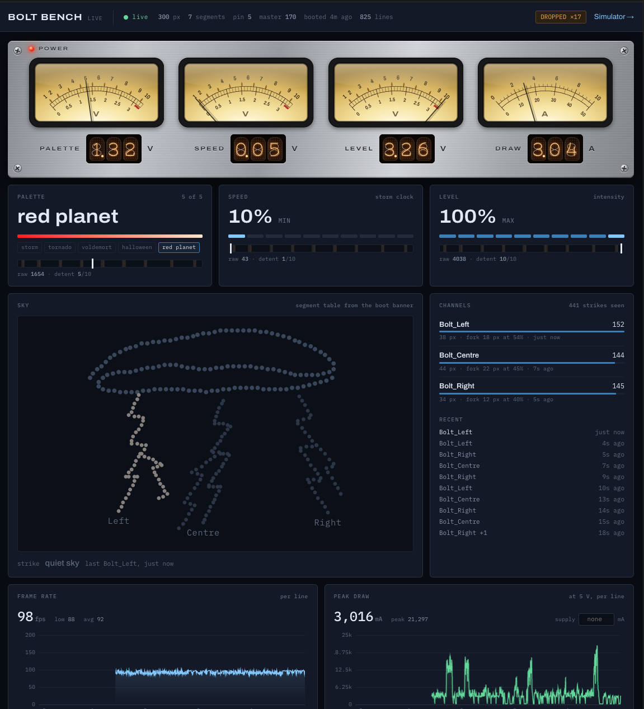

# Bolt Bench

A browser bench for designing lightning animations on a 300-pixel addressable LED strip, and for exporting the result as an ESP32 sketch that runs the same math.

Built for a wearable cloud costume: an LED rope stuffed into polyfill batting, with bolts hanging below.

## The problem

Writing lightning on a microcontroller is a bad feedback loop. Every tweak to a timing constant costs a compile, an upload, and a look — call it thirty seconds — and the thing you are trying to judge lasts twenty-two milliseconds. You cannot see a stepped leader at full speed. You certainly cannot see it while wearing the costume, in a dark room, holding a laptop.

The second problem is spatial. A cloud lights up in sympathy with the bolt that leaves it, brightest near the channel root and falling off with distance. That effect depends on where each pixel physically sits inside the batting — information that exists in your head and in the rope you twisted, but nowhere in the firmware.

This tool closes both gaps. You draw the routing, tune the storm at a tenth speed with a scope running, and export a sketch that carries the pixel coordinates with it.

## What this is

One self-contained HTML file. No build step, no dependencies, no server required. The only network request is a Google Fonts stylesheet; offline it falls back to system faces and everything still runs.

## Quick start

```bash
open /Users/buzcarter/Code/lightning-simulator/index.html
```

Double-clicking the file works too.

If you want your slider tuning to persist between sessions, serve it instead — browsers treat `file://` as an opaque origin and may discard `localStorage`. Every storage call is wrapped in `try`/`catch`, so it degrades quietly rather than breaking:

```bash
npx serve .
```

## How it's wired

### 1. Routing: SVG paths become LED indices

Routing is a list of **runs** in wiring order. Each run is one length of rope: a path plus a pixel count. The page samples that path at even arc-length intervals using `getTotalLength()` / `getPointAtLength()`, so pixels land evenly spaced along the curve no matter how it bends.

Indices are allocated cumulatively down the list. The default layout is:

| Run | Role | Count | Indices |
|---|---|---|---|
| Cloud body | cloud | 132 | `leds[0…131]` |
| Bolt · left | root channel | 38 | `leds[132…169]` |
| Fork · left | forks off left at 55% | 18 | `leds[170…187]` |
| Bolt · centre | root channel | 44 | `leds[188…231]` |
| Fork · centre | forks off centre at 45% | 22 | `leds[232…253]` |
| Bolt · right | root channel | 34 | `leds[254…287]` |
| Fork · right | forks off right at 40% | 12 | `leds[288…299]` |

Change any count and everything downstream shifts, in the UI and in the export together. Reorder runs with the arrows to match how you actually wired the rope.

The drawing surface is a 1000 × 760 viewBox. You can build paths three ways: click points directly on the stage (press `E` for edit mode), drag the handles to adjust, or paste an SVG `d` attribute straight out of Illustrator or Inkscape. Cloud runs smooth their points into Catmull-Rom curves; bolt runs stay as hard polyline zigzags, because that is what lightning looks like.

Parent links are stored by run id rather than by position, so reordering or deleting runs never silently reassigns a fork to the wrong channel. Cycles are detected on every rebuild and broken by detaching the offending run.

### 2. The math contract

This is the part that makes the preview worth trusting. The animation is not JavaScript that resembles Arduino code — it is the same arithmetic, transcribed:

- **`sin8`, `cos8`, `scale8`, `qadd8`, `qsub8`** are FastLED's `lib8tion` functions, including the `b_m16_interleave` lookup table `{0, 49, 49, 41, 90, 27, 117, 10}` that gives `sin8` its particular piecewise shape. Everything per-pixel is `uint8`.
- **`random16()`** is FastLED's LCG, `seed = seed * 2053 + 13849`, and `random8()` returns the low byte plus the high byte the way FastLED does. Both sides seed `0x1337`, so the hardware replays the storm you tuned rather than an unrelated one.
- **`hash8(index, frame)`** is stateless per-pixel noise. Flicker has to be reproducible frame to frame, which a sequential PRNG cannot give you when pixels are visited in a different order.
- **`dist8`** is an octagonal distance approximation, `max + min * 85/256`, roughly `hypot` within a few percent using no square root and no floats.

Every slider in the panel maps to a `#define` in the exported sketch.

### 3. The strike model

A strike is an **event**, precomputed at trigger time. When one fires, the tool rolls its leader speed, stroke count, per-stroke duration and brightness, and afterglow length, and freezes them into a struct. Rendering is then a pure function of elapsed milliseconds.

That is deliberate. It makes the preview scrubbable, it makes the same strike reproducible, and it maps cleanly onto a `millis()`-driven state machine on hardware.

The phases, with default tuning:

| Phase | Timing | What the pixels do |
|---|---|---|
| Stepped leader | 22–88 ms | A head races down the channel from the cloud end, leaving a decaying trail behind it |
| Return stroke | 12–46 ms | The whole channel goes white-hot, brightest and fastest of the sequence |
| Restrikes | 1–4 strokes, 30–140 ms apart | Repeat flashes at varying brightness; some only light *part* of the channel, as real restrikes do |
| Afterglow | ~330 ms | The whole tree decays and cools — heat drops from 255 toward 0, and colour slides from white to blue |
| Cloud decay | 540 ms | The cloud holds its glow longer than the bolt, which is what sells the depth |

Bolt runs also taper toward the tip, so the channel thins out as it descends.

### 4. Forks

A fork is a real second length of rope, attached partway down another channel — so it is modelled as a run with a **parent** and an **attachment point** (`forkAt`, 0–255 along the parent), not as a rendering trick.

Two things make it read as lightning rather than as two bolts that happen to fire together:

**The fork's leader launches late and travels at the same speed.** It starts when the parent's leader head reaches the attachment point, and its duration is scaled by length, `parentLeaderMs × forkLen / parentLen`. Propagation velocity is therefore constant across the whole tree, which means a branch and its trunk reach the ground at about the same moment. That is what real forked lightning does, and it is the detail that sells it.

**Forks sit out some restrikes.** Real return strokes often re-illuminate only the main channel. Each strike rolls a `forkMask` at creation time — one bit per stroke, the return stroke always set — and branches light only on the strokes whose bit is set. Two sliders control this: **Fork brightness** (how much dimmer a branch is than its trunk, compounding at each level) and **Fork restrike** (the odds a given restrike travels into the branches).

Forks nest. A fork can itself have forks, to a depth of 3.

Only root channels are ever struck directly — the storm scheduler and `randomBolt()` both filter to `parent < 0`. Clicking a branch on the stage fires the channel it belongs to.

In the routing list, every bolt run gets a **fork of** selector and an attachment percentage. The fork's first point is pinned to its parent's path and redraws when you move the parent or change the percentage, because the rope really is attached; it shows as an amber handle and is the one point you cannot drag.

### 5. Cloud sympathy, and why coordinates ship with the sketch

When a bolt fires, every cloud pixel picks up light based on its **2-D distance from that bolt's root** — not its distance in strip-index space. A rope serpentining through batting has neighbours in space that are nowhere near each other in index order, and index-space falloff looks obviously wrong.

So the export includes the geometry:

```c
const uint8_t LED_X[NUM_LEDS] PROGMEM = { ... };
const uint8_t LED_Y[NUM_LEDS] PROGMEM = { ... };
```

Positions are normalised to 0–255 across the long axis, which keeps distances isotropic. Each segment also records its own root point (`ox`, `oy`). This is the payload that makes the SVG matter to the microcontroller instead of being just a preview toy.

### 6. Colour: the hue lives in the afterglow

What makes this read as lightning is not the colour, it is the **heat axis** — the channel is white-hot at the stroke and cools to a tint as it fades. So the colour model is a ramp between two endpoints, and `heat` walks between them:

```c
leds[i].r = qadd8(leds[i].r, scale8(mix8(coolC.r, hotC.r, heat), bright));
```

`coolC` is the fully saturated `HUE` at `SAT`. `hotC` is `HOT_HUE` at `HOT_SAT`, the latter kept low so the return stroke holds a near-white core. That constraint is the whole trick: push `HOT_SAT` up and the effect stops looking like lightning and starts looking like a coloured tube light. Hue belongs in the decay, not the strike.

**The ramp shifts hue, not only saturation.** Desaturating toward white adds green and blue equally. From blue that gives blue-white and reads as hot; from red it gives *pink*, because nothing in nature gets hot by going pink — fire runs red → orange → yellow → white. `HOT_HUE` lets the peak sit at a different hue from the afterglow, so a red palette cools from an amber core rather than a salmon one. Leave it equal to `HUE` where no shift is wanted.

The tell is the gap between green and blue at the peak, not the ordering of the channels. Red planet used to peak at `#f69e95` — green 158, blue 149, a 9-point gap, which is pink. It now peaks at `#d7af86` — a 41-point gap, unmistakably amber.

Both endpoints are resolved **once per frame**, not per pixel, so the per-pixel cost is three `mix8` and three `scale8` — the same as when the palette was hardcoded blue.

`TRIM` compensates for the eye rather than the LED. Green sits at the peak of human luminous sensitivity, so a green flash at `MASTER` 170 reads about twice as bright as blue at 170. Starting points live in `PALETTES[]` in `config.h`:

| Palette | Hue | Hot hue | Sat | Hot sat | Trim | Reads as |
|---|---|---|---|---|---|---|
| ice blue | 150 | 150 | 120 | 25 | 255 | light blue, nearly white at the peak |
| periwinkle | 176 | 208 | 150 | 45 | 250 | blue afterglow from a pinkish core |
| deep blue | 160 | 160 | 245 | 50 | 255 | saturated midnight blue |
| sea foam | 120 | 128 | 170 | 30 | 215 | turquoise |
| lavender | 200 | 200 | 115 | 25 | 245 | light purple |
| deep purple | 190 | 190 | 250 | 60 | 240 | dark violet |

The palette cycle runs through them in that order. The chaos button has its own pair, `CHAOS_PALETTES[]`, which it crossfades to and sways between while it rages, then fades back into the cycle:

| Chaos palette | Hue | Hot hue | Sat | Hot sat | Trim | Reads as |
|---|---|---|---|---|---|---|
| tornado | 80 | 64 | 165 | 30 | 200 | sickly yellow-green — the dread is in the *low* saturation |
| wisp | 110 | 112 | 215 | 40 | 195 | eerie blue-green |

The bench runs FastLED's own `hsv2rgb_rainbow`, transcribed, so the swatches and the preview land on the same RGB the strip will.

## Using the bench

### Controls

| Key / action | Effect |
|---|---|
| `Space` | Play / pause |
| `S` | Fire a random bolt |
| `E` | Toggle routing edit mode |
| `Backspace` | Remove the last point (edit mode) |
| Click a bolt on the stage | Fire that specific bolt |
| Rate slider | 0.03× to 2.00× |

Drop the rate to about **0.10×** when tuning. A 22 ms leader is invisible at full speed and obvious at a tenth.

### The two instruments

**The filmstrip** under the stage is literally `leds[0…299]` — the buffer the controller ships, drawn one pixel per LED and scaled up. It carries an index ruler every 25 pixels and labelled segment brackets. This is where you catch an off-by-one in your wiring order.

**The scope** below it plots channel peak against cloud mean over roughly a ten-second window. Use it to balance afterglow against cloud decay: if the white line drops to zero long before the blue fill does, the cloud is holding too long, and vice versa.

Four presets — Distant storm, Rolling, Direct hit, Heat lightning — are starting points, not destinations.

## Export

The **Export** panel emits seven source files plus the layout. They are split along the line of **ownership**, not by size — which is what makes re-exporting safe:

| File | Owner | Overwritten on export |
|---|---|---|
| `config.h` | **you** — pins, logging, palettes | never; the bench emits it as a starter only |
| `controls.h` | **you** — keyboard controls, chaos button | never; starter only |
| `layout.h` | generator — segments, `LED_X`/`LED_Y` | wholesale |
| `tuning.h` | generator — animation parameters | wholesale |
| `storm.h` | generator — the engine: renders each frame into `leds[]` | wholesale |
| `strip.h` | generator — the output: brightness, white balance, power cap, the wire | wholesale |
| `main.cpp` | generator — `setup()` / `loop()` | wholesale |

Drop the five generated files into `src/` after any export; leave your `config.h` and `controls.h` alone.

**The colour math is FastLED's; the driver is not.** `storm.h` uses FastLED's `lib8tion`, `CRGB` and `hsv2rgb_rainbow`, because the bench transcribes them bit for bit. `strip.h` sends the frame with Adafruit NeoPixel. FastLED 3.10's ESP32 output lit the right number of pixels on this board, but every colour came out white; NeoPixel on the same board and strand showed the colours correctly. FastLED is pinned in `platformio.ini` so the math cannot drift under the bench.

`layout.json` round-trips back into the tool via **Import layout JSON**, so you can version your routing or move it between machines.

Both use Copy rather than a download — this page is often viewed in a sandboxed frame where browser-initiated downloads are blocked, and a Copy button that always works beats a download link that sometimes does not.

### Logging

The sketch logs to serial at 115200 (matching `monitor_speed` in `platformio.ini`). Every log line is behind one flag:

```c
#define STORM_LOG  1     // 0 removes all of it
```

Setting it to `0` — or passing `-DSTORM_LOG=0` in `build_flags`, since the define is `#ifndef`-guarded — drops Serial, the format strings, and the per-frame power measurement entirely. On an ESP32 that is **28 KB of flash and 368 bytes of RAM**, so the off switch is real rather than cosmetic.

Output is a **dashboard, not a log**: one line carrying the current picture, rewritten when something a person would notice changes and refreshed on a slow timer when nothing does. There is no scrollback of every strike and every key press.

```
palette: sea foam    speed: 60%         cloud: 50%         level: 40%        | strike: Bolt_Left        | fps:  98  mA: 3180
palette: sea foam    speed: 60%         cloud: 50%         level: 40%        | strike: Bolt_Centre      | fps:  97  mA: 4020
palette: sea foam    speed: 60%         cloud: 50%         level: 40%        | strike: _                | fps:  99  mA:  240
palette: lavender    speed: 70%         cloud: 50%         level: 80%        | strike: Bolt_Centre +1   | fps:  96  mA: 5110
```

`strike` names the **root channel** of the active strike, or `_` when the sky is quiet. A strike lights its whole tree, and forks never fire on their own, so a fork is never the answer here; overlapping strikes show as `name +N`.

Fields are fixed-width on purpose. A dashboard whose columns jump around is unreadable at a glance, which is the only thing it is for.

Two lines still print outside this. `DROPPED` is a fault rather than a state — it means the storm is scheduling faster than `MAX_STRIKES` can render — and the boot banner dumps the segment table once so you can check the firmware's idea of the routing against the bench's.

The `mA` figure is the peak draw since the previous line, measured on what `strip.h` actually sends, after brightness, white balance and any cap. It uses FastLED's per-channel power model, so it is the number to watch against whatever supply you end up using — see below.

### Live dashboard

The same line can drive a page in the browser. `pio device monitor` keeps the serial port and your terminal exactly as before; a monitor filter, `monitor/filter_dashboard.py`, also sends each line as a UDP packet to a small Node service in `dashboard/`. The service turns the lines into one picture of the board and streams it to any open page.

```bash
node dashboard/server.js      # then open http://localhost:7778/
pio device monitor            # in another terminal, as usual
```



The filter is switched on in `platformio.ini` (`monitor_filters = default, dashboard`). It sends UDP so the monitor never waits on the dashboard, and never notices whether it is running: with nothing listening, the packets are simply dropped. The service has no dependencies, so there is no `npm install`, and it needs Node 18 or later.

Across the top is a meter rack: one backlit, dual-scale meter per setting (palette, speed, cloud, level) and one for the draw, each with a nixie readout. A setting's meter reads its step, numbered on the upper scale, with what the step means below: the speed multipliers, the level percentage. The draw meter shows amps above and watts at 5 V below, with a red zone from the supply limit you type in. The needles swing to each new reading with a CSS transition. The digits update at most twice a second. The build asks for a status line at least every 750 ms (`STORM_LOG_STATS=750`), so the meters keep moving even when nothing changes. The pilot lamp is red while lines are arriving and amber when the board goes quiet.

Below the rack, the page shows the four settings. It draws the cloud from the pixel coordinates in `layout.h` and lights each strike's tree in the current palette's colours. It also counts strikes per root channel, charts frame rate and peak draw over the last five minutes against a supply limit you type in, and keeps a tail of the raw serial. The segment table comes from `src/layout.h` until the board's boot banner provides its own.

The page reads the stream with Server-Sent Events rather than a WebSocket: data only flows one way, and `EventSource` reconnects by itself. Ports are `STORM_DASH_UDP` (7777) and `STORM_DASH_HTTP` (7778). The page is served on localhost only unless `STORM_DASH_BIND=0.0.0.0`. The service also serves the bench at `/simulator`.

To work on the page without a board, use `node dashboard/server.js --demo`, which runs a pretend board inside the service. `node dashboard/fake-bench.js` instead sends the pretend board's lines over UDP, the way the monitor filter does. `npm test` in `dashboard/` checks the parser against the formats in `storm.h`. If you change a `LOG()` format there, change `dashboard/public/parse.js` to match.

### Hardware notes

**300 pixels will not fit on an AVR Nano.** The frame buffer alone is 900 bytes of a 2 KB budget, before strike state. Use an ESP32, Teensy, or RP2040.

**Power is the real constraint.** WS2812B pixels draw roughly 60 mA each at full white. All 300 at once is about 18 A at 5 V, or 14.8 A at the default master brightness of 210. Sheet-lightning flashes genuinely do drive most of the cloud near white simultaneously, so that peak is real, not theoretical — even though the flashes are brief enough that average draw stays low.

What that means in practice:

- Cap the draw with `LED_MAX_MA` in `config.h` rather than trusting the animation to behave. A frame that would draw more is dimmed as a whole to fit. It ships at `0` (no cap); set it to what your supply delivers. This is the single most useful line you can change.
- Inject power at both ends of the strip, and at the midpoint if you can reach it.
- Put a 1000 µF electrolytic across 5 V and ground at the strip, and a 330–470 Ω resistor in series with the data line.
- Level-shift 3.3 V data up to 5 V on ESP32 and RP2040.

A sagging supply does not fail cleanly — it produces glitching and colour corruption that looks exactly like a software bug, and will cost you an evening.

The strip is on `GPIO18` (`LED_PIN`), WS2812B with `GRB` order (`LED_TYPE`), in `config.h`. Not GPIO2: that pin also drives the DevKit's on-board blue LED, which loads the data line, and it is a boot strapping pin.

## Known limits

- **Dithering is gone with FastLED's driver.** FastLED's `show()` added temporal dithering at low brightness; NeoPixel does not, so the dimmest fades step slightly more coarsely than they did.
- Fork nesting is capped at depth 3, in both the preview and the sketch.
- `MAX_STRIKES` is 6 and `MAX_STROKES` is 6. Push the storm parameters hard enough and strikes will be dropped rather than queued.
- Preview-only controls — dot size, bloom — model light diffusing through batting. They are not exported, because the controller has no equivalent.

## Controls

There are no knobs. Palette, speed, cloud speed and level are set from the keyboard of the computer the board is tethered to, typed into `pio device monitor` (which passes keys through to the board over the same USB cable). The chaos button is the only input on the board itself. The whole build (board pinout, chaos button and strip) is on the [wiring diagram](docs/wiring-esp32.svg).

| Key | Does |
|---|---|
| `p` `s` `c` `l` | pick palette, speed, cloud speed or level |
| `+` `-` | step it up or down; past either end it wraps to the other (`=` and `_` work too, so shift is optional) |
| `h` | hold mode on/off: one segment lit steady, the storm paused |
| `0`–`6` | while holding, the segment to light, in the order the boot banner lists them (0 is the cloud body) |

Each change prints a `[keys]` line with the new value, and the dashboard line follows. The keys need `STORM_LOG 1`, which is what opens the serial port; without it the settings stay at their start values.

The board starts on speed 7 (70%, 1.32×), cloud 6 (60%, 1.00×) and level 9 (90%), and **cycles the palettes on its own**, a new one every 22 seconds. Changing the palette by hand restarts the 22 seconds, so a palette you pick gets its full turn. Both are set at the top of `controls.h`: `START_PALETTE`, `START_SPEED`, `START_CLOUD`, `START_LEVEL` and `PALETTE_CYCLE_MS` (0 turns the cycle off). Each change prints a `[cycle]` line.

**Palette carries a whole look per step, not a hue.** Rotating hue alone leaves `SAT` wherever the export left it, and at low saturation every hue is the same near-white. Each step sets hue, saturation, peak saturation and trim together from `PALETTES[]` in `config.h`; there are as many steps as rows there.

**Speed is geometric**, 0.25× to 3.03× across 10 steps, with step 6 at exactly 1.00× (`SPEED_Q8` in `controls.h`). Equal presses give equal ratio changes.

It drives a **virtual clock, not scaled `millis()`**. Scaling `millis()` directly would teleport every strike in flight the instant the speed changed. `stormClock()` accumulates instead — the same thing the bench does with `simTime += dt * speed`. It keeps the fraction of a millisecond each frame, so 0.25× really is 0.25× at 100 fps.

**Cloud speed** runs the cloud's ambient shimmer on a clock of its own (`cloudClock()`), from the same 0.25×–3.03× table. Speed runs the bolts, and with them the cloud's flash in sympathy with each strike, which belongs to the strike. At equal speeds the two clocks read the same, which is what the bench previews; the bench itself has only the one speed.

**Level** has 10 steps, 0 to 100% in ninths. Step 1 is `LEVEL_FLOOR`, not off.

**Hold** is for checking the wiring against the bench's routing: the chosen segment shows in the palette's peak colour at the level's brightness, everything else is dark, and each pick prints its pixel range. The storm's clock stops while holding, chaos is cancelled, and it resumes from a clear sky when hold ends.

## Chaos button

A momentary button between `GPIO27` and ground, using the internal pull-up — two wires, no resistor. `CHAOS_ENABLE 0` compiles it out. Not on GPIO34–39: those have no internal pull-ups.

A tap has a **shape**, rather than being a flat flash:

| Phase | Duration | What happens |
|---|---|---|
| Volley | instant | Every root channel fires, staggered 90 ms so it reads as a cascade, not one white frame |
| Hold | 2.5 s | Scheduler gaps collapse from 1400–5200 ms to 90–260 ms, every strike doubles, brightness ignores the level setting and goes to the ceiling |
| Decay | 2.0 s | All three ease back to the settings, like the storm moving off |

The envelope runs in **real** milliseconds while the strikes it schedules run on the **storm** clock — so a tap always lasts about four and a half seconds regardless of the speed setting. Tapping again restarts it. The dashboard reads `level: CHAOS` throughout.

The scheduler's gap and double-strike settings became runtime values to make this work, which is a down payment on the severity crossfade — that will drive the same three.

## Severity and the presets

Worth recording, because the obvious mapping is wrong: **the four bench presets are not one axis.** Distant storm → Rolling → Direct hit is a genuine severity ladder, with Rolling in the middle. Heat lightning is not on it — that is cloud-only sheet lightning with no channel strikes, a different *kind* of storm rather than a milder one. It belongs with the palette setting.

So severity crossfades Distant ↔ Direct hit, and Heat lightning stays a separatechoice of its own.

## Building the firmware

```bash
pio run                 # compile
pio run -t upload       # flash
pio device monitor      # watch the log (and feed the live dashboard, if running)
```

`platformio.ini` targets `esp32dev`. Re-exporting overwrites five of the seven source files, but never `config.h` or `controls.h` — so your pin choice, logging settings, palettes and controls survive.

## Files



```
lightning-simulator/
├── index.html        the bench: routing, tuning, export
├── README.md         this file
├── platformio.ini    ESP32 build config
├── monitor/
│   └── filter_dashboard.py    copies monitor output to the dashboard over UDP
├── dashboard/        live dashboard: Node service (no deps) + page
│   ├── server.js     UDP in, Server-Sent Events out, serves the page
│   ├── firmware.js   reads segments, palettes, speed and level steps out of src/
│   ├── fake-bench.js pretend board for working without hardware
│   └── public/       index.html, plus parse.js and state.js shared with the service
├── docs/
│   ├── wiring-esp32.svg       full wiring diagram, DevKit V1 pinout
│   └── wiring-esp32.py        regenerates the SVG
└── src/
    ├── config.h      YOURS: pins, logging, palettes — never regenerated
    ├── controls.h    YOURS: keyboard controls, chaos button — never regenerated
    ├── layout.h      generated: segment table, pixel coordinates
    ├── tuning.h      generated: animation parameters and palette
    ├── storm.h       generated: the engine, renders each frame into leds[]
    ├── strip.h       generated: sends leds[] to the strip (NeoPixel)
    ├── main.cpp      generated: setup() and loop()
    └── layout.json   exported routing, re-importable into the bench
```

